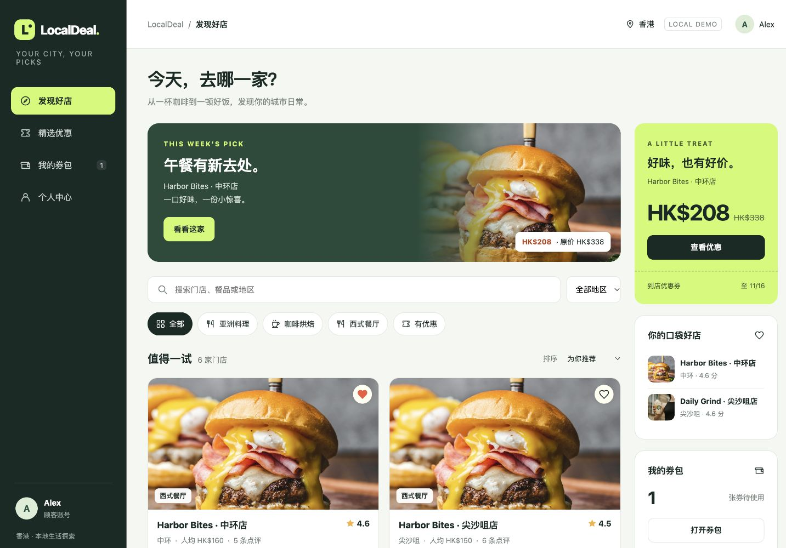

# LocalDeal

**A database-centered smart dining recommendation and merchant analytics application for Course 5003, Track 1.**

[GitHub repository](https://github.com/fljt-ai/localdeal-5003) · [中文启动指南](README.zh-CN.md) · [Architecture](docs/ARCHITECTURE.md) · [API](docs/API.md) · [Demo guide](docs/DEMO-GUIDE.md)

The GitHub repository was made public on 2026-11-26. The November upgrade adds explainable recommendations, group dining matching, merchant analytics, a transaction contention evaluation, and English / Simplified Chinese display; see [Smart features](docs/SMART-FEATURES.md).

LocalDeal helps customers discover fictional Hong Kong restaurants, save favorites, share reviews and purchase simulated dining vouchers. Authorized store staff can inspect their branch orders and redeem vouchers; branch owners/managers can adjust unsold inventory. A vanilla JavaScript frontend connects to a layered FastAPI/Pydantic backend and a persistent SQLite database (a dependency-free compatibility server is also provided).



Upgraded interface previews: [personalized ranking](docs/images/personalized-recommendation.png) · [group matching](docs/images/group-match.png) · [merchant analytics](docs/images/merchant-analytics.png).

## Features

- Search restaurants by name, district, category, menu item or tag; filter and sort in SQL.
- Browse offers and full store details with menu items, ratings and paginated reviews.
- Register or sign in, manage favorites, edit your own reviews and export your own records.
- Purchase simulated vouchers with stock checks, immutable purchase snapshots and idempotent retries.
- View a private voucher wallet with unused, redeemed and expired status filters.
- Redeem vouchers through a merchant workspace restricted to assigned branches.
- Load bounded pages with complete totals; keep store ratings independent of the current review page.
- Explain recommendations computed from personal favorites, positive reviews, purchases, public reputation and active discounts; use a public fallback for guests and new users.
- Match 2–8 diners by a hard shared budget/region constraint and a worst-member-first preference ranking.
- Reset group dining preferences and results when the signed-in identity changes or the session expires.
- Adjust unsold voucher stock, preserving purchase/redemption history; reject stale stock updates.
- Browse 18 fictional branches and 18 offers in a fresh rich demo with real pagination.
- Inspect and call the API using offline Swagger UI and OpenAPI.
- View branch-scoped 7/30-day simulated sales, coupon rankings, redemption outcomes, review summaries and stock replenishment advice in the merchant workspace.
- Switch between English (default) and Simplified Chinese using the top-bar selector. The preference is stored in the browser; account data, orders, filters and user-authored reviews remain unchanged. The fictional catalogue is translated for display, with common English search aliases.

All restaurant details, accounts and transactions are fictional. Payments are simulated.

## Quick start

Use **Python 3.10 or later**. Install the API dependencies once for the recommended FastAPI runtime; no frontend build step is required. For Python-only offline use, the compatibility server supports all business features except Swagger/OpenAPI.

1. Download and extract the source package or the [public repository](https://github.com/fljt-ai/localdeal-5003). No GitHub sign-in is needed for public read access. The bilingual upgrade includes `frontend/src/i18n.js`.
2. Open a terminal in the project root, beside `run.py`.
3. Run (macOS; on Windows replace `python3` with `py -3`):

```sh
python3 -m pip install -r requirements.txt
python3 -B run.py --engine fastapi --smart-demo
```

4. Open [http://127.0.0.1:8787](http://127.0.0.1:8787) in a browser.
5. Keep the terminal open. Press **Control+C** to stop the server.

The **smart-feature recording demo** initializes a separate `database/localdeal-smart.db` (18 fictional branches, 18 offers, 114 orders and 126 reviews at first launch) and preserves any existing file. For a new demonstration without changing an older rich database, append `--db database/localdeal-smart-expanded.db`. Normal startup without `--smart-demo` keeps the original six-store seed. Open [Swagger UI](http://127.0.0.1:8787/docs) or [OpenAPI JSON](http://127.0.0.1:8787/openapi.json) with FastAPI; all Swagger assets are bundled locally.

Without installing packages, run `python3 -B run.py --engine legacy --smart-demo` (Windows: `py -3 -B run.py --engine legacy --smart-demo`). Default `--engine auto` selects FastAPI if dependencies are installed, otherwise the compatibility server.

Optional Docker Desktop: run `docker compose up --build`. The service is published on host loopback only; the named volume preserves the database. Use `docker compose down` to stop without removing the volume.

On Windows, use `py -3 -B run.py --smart-demo` if that is your Python launcher, or `start-windows.cmd`. On macOS, `start.command` also starts the rich demo; if the OS blocks the downloaded script, use the terminal command above. Open the HTTP address to use the app; opening `frontend/index.html` directly does not connect to the backend.

Use `python3 -B run.py --port 8788` if the default port is occupied. `--db /path/to/copy.db` selects a separate database, and `--verbose` logs HTTP requests. On systems where Python has no IANA time-zone data, install the `tzdata` package to provide the `Asia/Hong_Kong` time zone; see the [Python time-zone documentation](https://docs.python.org/3/library/zoneinfo.html#data-sources).

To obtain the current online source, clone the repository and enter its project directory:

```sh
git clone https://github.com/fljt-ai/localdeal-5003.git
cd localdeal-5003
```

## Demo accounts

The public **fictional demo password** for these accounts is `LocalDealDemo!2026`.

| Role | Email | Access |
| --- | --- | --- |
| Customer Alex | `alex@example.com` | Personal profile, reviews, favorites and wallet |
| Harbor Bites owner | `harbor.owner@example.com` | Authorized Harbor Bites branches, inventory and redemption |
| Little Dumpling owner | `dumpling.owner@example.com` | Authorized Little Dumpling branches, inventory and redemption |
| Daily Grind owner | `coffee.owner@example.com` | Authorized Daily Grind branches, inventory and redemption |

Newly registered accounts are customers. The [demo guide](docs/DEMO-GUIDE.md) describes purchasing a voucher as a customer and redeeming it with the corresponding merchant account.

## Data and database model

First startup creates `database/localdeal.db`, seeds fictional examples using the current Hong Kong date, and migrates the core schema to application version 2. Later startups preserve existing records. The source repository excludes local databases and session records; each checkout creates its own database.

The fresh demo contains 9 users, 3 merchants, 6 stores, 18 menu items, 6 offers, 30 reviews, 3 orders, 1 redemption and 2 favorites. Expired orders retain their historical expiry dates.

The application has **16 tables, 3 views, foreign keys, checks, indexes and transaction/history guards**. The core v1 schema has 15 tables; v2 adds server-side sessions. Prices are stored as integer Hong Kong cents; events use UTC Unix seconds and expiry rules use Hong Kong calendar dates.

- [Current 16-table ER source](database/docs/ER-DIAGRAM.md)
- [Core database design and normalization notes](database/docs/DATABASE-DESIGN.md)
- [Schema](database/schema.sql), [session migration](database/migration_v2.sql), [sample SQL queries](database/queries.sql)

The older `database/docs/er-diagram.svg` shows the 15-table core model and omits the added session table. Back up personal demo data by stopping the server and copying `database/localdeal.db`.

## Repository structure

```text
localdeal-5003/
├── run.py                  # Local server entry point
├── start.command           # macOS launcher
├── frontend/               # HTML, CSS, JavaScript, local photos and UI checks
├── backend/                # HTTP routing, sessions, authorization and services
├── database/               # Schema, migration, seed data and transaction logic
├── tests/                  # Isolated HTTP integration tests
├── evaluation/             # Synthetic data, benchmarks, raw results and figures
├── docs/                   # Architecture, API, demo and course delivery notes
└── .github/workflows/      # Database, API and frontend checks
```

## Tests

From the project root:

```sh
python3 -B -m unittest discover -s database/tests -v
python3 -B -m unittest discover -s tests -v
```

Optional frontend checks use Node.js 18 or later, without npm packages:

```sh
node frontend/tests/http-api.test.js
node frontend/tests/app-state.test.js
```

The tests create temporary databases and preserve the running demo database. Install `requirements-dev.txt` to run the FastAPI contract tests. See the [architecture upgrade](docs/ARCHITECTURE-UPGRADE.md), [smart-feature validation](docs/SMART-FEATURES.md), [application validation](database/docs/VALIDATION.md) and [frontend validation](frontend/docs/FRONTEND-CHECKS.md).

[GitHub Actions](.github/workflows/checks.yml) is configured for Python 3.10/3.14 on Ubuntu and Windows, and Node 22 on Ubuntu. See [Actions](https://github.com/fljt-ai/localdeal-5003/actions) for results of the corresponding published commit. The workflow follows GitHub's [workflow syntax](https://docs.github.com/en/actions/reference/workflows-and-actions/workflow-syntax).

## Evaluation

Reproducible experiments use temporary synthetic databases:

```sh
python3 -B evaluation/benchmark.py
python3 -B evaluation/pagination_benchmark.py
python3 -B evaluation/transaction_benchmark.py
```

The first compares preserved SQL workloads with and without 13 explicit business secondary indexes. The second compares the former complete guest response with a compact bootstrap plus the first 12 stores, using the same indexed data and JSON encoding boundary.

The largest dataset has **2,000 stores, 100,000 reviews and 50,000 orders**. In the 2026-11-27 experiment with recommendation ranking, the combined guest homepage responses decreased from **28.64 MiB to 13.24 KiB**; median service assembly plus JSON encoding decreased from **339.94 ms to 27.25 ms** over 30 measured runs per condition. The additional ranking work costs more than the earlier simple sorting version. The transaction evaluation used 100 simulated buyers competing for 10 vouchers, with 1, 8 and 32 workers across 15 runs; every run sold exactly 10 without overselling. These local measurements exclude HTTP, network and browser costs.

[Evaluation guide](evaluation/README.md) · [Index report](evaluation/results/2026-10-03/summary.md) · [Current pagination and ranking report](evaluation/results/insights-pagination-2026-11-27/summary.md) · [Transaction contention report](evaluation/results/transactions-2026-11-27-125150/summary.md)

Raw JSON samples and figures are included. Recreating plots optionally requires Matplotlib; the app and benchmark timing scripts do not use it.

## Group work and course delivery

See [contributing](CONTRIBUTING.md), the [group contribution record](docs/CONTRIBUTIONS.md), [publication instructions](docs/GITHUB-PUBLISH.md) and [project status](docs/PROJECT-STATUS.md).

Group members can read public code without an invitation. For direct write access, the owner can invite their GitHub accounts through **Settings → Collaborators → Add people**. Verify that the final version and video are accessible to the instructor before submission. See GitHub's [collaborator invitation guide](https://docs.github.com/en/repositories/managing-your-repositorys-settings-and-features/repository-access-and-collaboration/inviting-collaborators-to-a-personal-repository).

The final course delivery still needs the confirmed 4–8 group members and undergraduate majors, actual contributions, verified teacher access to the [repository](https://github.com/fljt-ai/localdeal-5003), a 5–8 minute demonstration video and the final `XXXX-report.pdf`. This README is the runnable-code guide, not the final course report. Codex assistance is recorded in the contribution document for the group to review and disclose according to course rules.

## Credits and scope

Food photographs are credited in [asset sources](frontend/docs/ASSET-CREDITS.md). Technical references appear in the architecture and evaluation documents. No project open-source license has been selected; the photographs retain their source terms.

This is a local course demo bound to the loopback interface. It includes password hashing, server-managed sessions, CSRF checks and branch authorization. Email verification, password recovery, real payments and public deployment are outside the implemented scope. Python's HTTP server is intended for this local demonstration; see the [Python documentation](https://docs.python.org/3/library/http.server.html).
