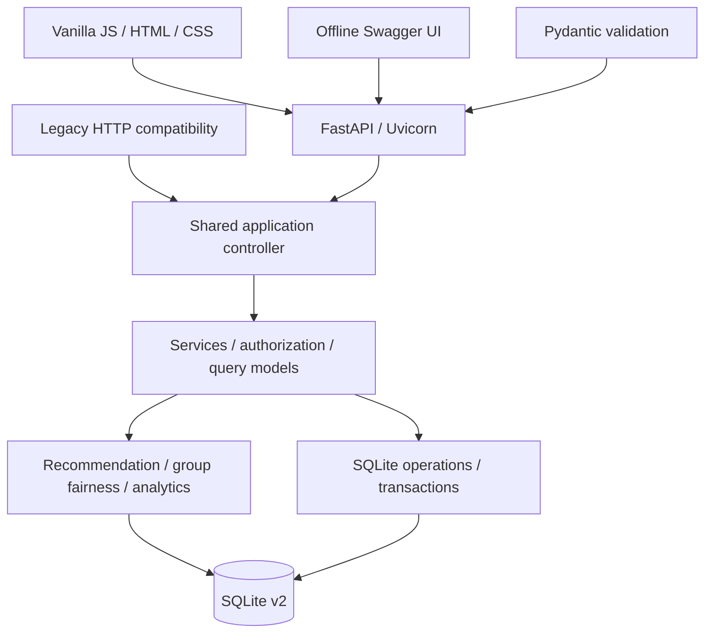

# LocalDeal — Architecture and workflow upgrade

## Design decision

Keep the relational design (16 tables / 3 views), existing SQL recommendation and analytics queries, and bilingual browser UI. Introduce a FastAPI ASGI transport with strict Pydantic request models, Uvicorn, OpenAPI and a locally bundled Swagger UI. Both the FastAPI and Python-standard-library transports use one shared `backend/controller.py`, services and the same SQLite transaction operations. This is a modular monolith, not independent microservices; a single data store is appropriate for the local class demonstration and atomic purchase/inventory transactions.



## Enhancements requested by the team

| Issue | Design | Evidence |
|---|---|---|
| Group preferences survive a user switch | Reset temporary form, shared district, submitted query and results when identity changes or expires; invalidate old asynchronous responses | Browser and front-end regression tests |
| Small restaurant catalogue | Fresh rich demo adds 12 fictional branches using existing normalized merchant/category/staff/menu relations; 18 branches, 18 offers, 126 reviews and 114 orders total | Fresh fixture assertions; visible pagination in browser |
| Merchant stock controls | Owners/managers adjust available vouchers for their authorized branch. `BEGIN IMMEDIATE` serializes writes with purchases; expected stock prevents stale-page overwrite | HTTP tests and actual browser increase/decrease |

### Inventory correctness

For old available quantity `A`, new quantity `A'` and previously issued total `T`, the update is `available_stock=A'`, `total_stock=T+(A'-A)` in one transaction. Thus `T'-A'=T-A`: issued/sold history remains unchanged. A decrease can remove only unsold units. A target of zero is valid and prevents further purchases. Invalid, stale and unauthorized requests are rejected. Purchase and redemption snapshots are immutable; this does not create a separate inventory-adjustment audit ledger or change the database schema.

### Running and demonstrating

From the project root:

```sh
python3 -m pip install -r requirements.txt
python3 -B run.py --engine fastapi --smart-demo
```

On Windows use `py -3` instead of `python3`. Browse `http://127.0.0.1:8787`, and `http://127.0.0.1:8787/docs` for all API operations. Swagger assets ship with the source; no Internet or external CDN is needed at runtime. A compatibility mode (`--engine legacy`) preserves dependency-free use without Swagger. For existing rich databases, create a new path with `--db database/localdeal-smart-expanded.db`; no existing database is modified by the demo generator. Optional Docker Compose binds host loopback and persists data via its volume.

The Windows/Ubuntu matrix in `.github/workflows/checks.yml` installs Python dependencies, runs the database and API suites, and the frontend job uses Node. A separate Ubuntu Docker Compose job builds the image and verifies the live health, expanded catalogue, OpenAPI and bundled Swagger assets. Results must be observed on the corresponding runner/image rather than assumed from local macOS checks.

Local verification on 2026-11-27: 35 application tests (including FastAPI contract tests), 18 core database tests and both JavaScript check scripts passed. Actual browser verification on the FastAPI runtime showed 18 restaurants in two pages, stock adjustment 3 → 8 → 3, group state reset after a different user signed in, and a successful Swagger `GET /api/health` response. Docker and Windows execution were not exercised locally; the repository workflow defines the corresponding CI coverage.

### References

- [FastAPI documentation](https://fastapi.tiangolo.com/)
- [Pydantic documentation](https://docs.pydantic.dev/)
- [Uvicorn documentation](https://www.uvicorn.org/)
- [Swagger UI distribution (version 5.36.0)](https://www.npmjs.com/package/swagger-ui-dist/v/5.36.0); unmodified local assets with license and notice in `backend/vendor/swagger-ui`.
- [SQLite transactions](https://www.sqlite.org/lang_transaction.html)
