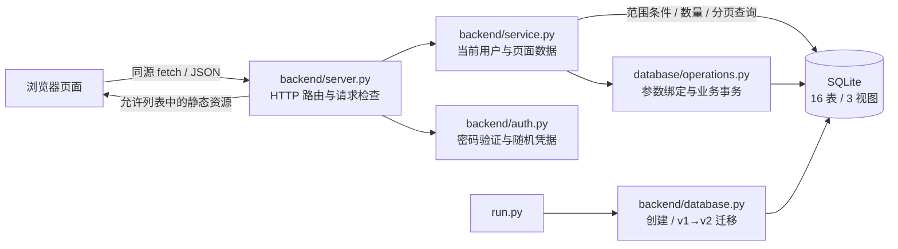

# LocalDeal 架构与模型版本

本应用使用原生 HTML/CSS/JavaScript、Python 3.10+ 标准库和 SQLite。前端与 API 由同一个 `ThreadingHTTPServer` 进程提供，默认仅绑定 `127.0.0.1:8787`；无需包管理器、前端编译或外部数据库服务。

## 分层责任

| 部分 | 责任 |
| --- | --- |
| `frontend/src/app.js` | 页面、表单、角色入口、筛选及分页状态，成功后重新读取相关摘要和页面 |
| `frontend/src/http-api.js` | 同源请求、JSON、Cookie、内存 CSRF 令牌与超时错误 |
| `backend/server.py` | 路由、Host/Origin/请求头检查、JSON 限制、响应与静态资源允许列表 |
| `backend/service.py` | 输入字段允许列表、服务端身份、SQL 范围和筛选、分页及 camelCase 页面对象 |
| `backend/auth.py` | PBKDF2 密码哈希、恒定时间比较和随机会话凭据 |
| `backend/database.py` | 缺失数据库初始化、事务迁移与完整性检查 |
| `database/operations.py` | 购买、核销、点评等核心业务操作和写入事务 |
| SQL 表、索引、视图、触发器 | 键关系、库存约束、购买历史及核销记录的完整性 |

每个 HTTP 请求使用独立数据库连接，连接启用外键并设定 5 秒 busy timeout。相关写操作以 `BEGIN IMMEDIATE` 开始；任何一步失败都回滚。SQLite 仍是单写者数据库，写锁等待失败会转换为可读的 `503 / DATABASE_BUSY`，不等于已证明大规模吞吐性能。

## 按页面读取数据

`GET /api/state` 只提供初始化资料：当前用户与 CSRF 令牌、当前用户的收藏和本人点评数量、个人订单按状态的数量、类别和地区字典，以及单家推荐门店和一项关联优惠。旧 `stores`、`coupons`、`reviews`、`favorites`、`orders`、`merchantOrders` 字段始终为空数组；浏览器不再通过这个入口加载整个数据库。

列表接口统一返回 `{items,total,limit,offset,hasMore}`。门店、优惠和收藏默认每页 12 条；点评、个人订单和商户订单默认每页 10 条。每页限制为 1–50 条，起点限制为 0–1000000。数量与当前页在同一读事务快照中查询，数量条件包含相同的筛选和授权范围。点评、订单、优惠及门店排序都以稳定编号消除并列，因此数据库不变时相邻页不会因为同分或同一时间而随机重叠。

门店查询在 SQL 中应用名称、英文名、类别、地区、可售菜单和标签搜索，以及类别、地区、可购买优惠筛选。`LIKE` 的通配符被转义，用户值通过参数绑定传入。评分和数量通过门店编号限定到对应店的完整点评，避免使用已经加载的点评页推算平均分；列表读取不调用全库聚合的 `store_summary`。推荐按门店编号排序，评分按平均分降序，人均价按金额升序，编号作为最后的并列排序条件。

门店卡片只携带最多三个标签、空菜单、当前用户的收藏标记，以及本店价格最低的可购买优惠。单店详情才读取该店的完整标签和可售菜单；`/api/stores/:id/menu` 是同一详情范围的菜单子接口。优惠和订单对象带门店名称、地区及图片，个人页或券包页无需先读取全部门店。

门店点评分页支持评分筛选和最新或评分排序。响应中的独立 `ownReview` 读取当前用户在该店的已有记录，即使它不在当前页或不符合评分筛选，也能进入编辑。公开点评页的 `total` 仍只统计当前筛选。新增和编辑成功后按点评编号读取单条结果，不扫描门店或全库的所有点评。

私有分页分别服务本人点评、收藏、个人订单和商户订单。收藏保留已保存但停用的门店并返回其状态。个人订单在 SQL 中固定为会话用户；商户订单通过有效员工关系关联授权门店，再查询对应优惠的订单，利用员工、优惠和订单索引。商户指定未授权门店时返回 403；省略门店参数时也仅返回授权门店。个人导出是明确的完整导出操作，在 SQL 中限定当前用户后读取其全部记录，独立于页面分页。

## 从核心 v1 到应用 v2

| 版本 | 定义与组成 | 用途 |
| --- | --- | --- |
| 核心 v1 | `database/schema.sql`，15 表、3 视图，`user_version=1` | 商户、门店、菜单、标签、点评、收藏、优惠、订单与核销模型 |
| 应用 v2 | v1 加 `database/migration_v2.sql` 的 `sessions` 表，16 表、3 视图，`user_version=2` | 当前 HTTP 应用的服务端会话 |

首次启动若目标路径不存在，先按运行当天的香港日期创建 v1 示例数据库，再进行 v2 迁移。已有 v1 文件在同一写事务中增加会话表并更新版本；已有业务记录不删除、不重新播种。只为编号和邮箱均匹配的九个虚构种子账号填入缺失的密码哈希，已有非空密码哈希保留。已有 v2 文件不会再次播种或重设密码。未知结构版本被拒绝，原文件保留。

`database/init_db.py` 是可单独使用的核心 v1 初始化工具，创建新路径并拒绝覆盖现有文件；它不是应用重置接口。`seed.sql` 使用固定 2026-10-02 基准，正常应用首次启动使用当前香港日期。原始前端和核心数据库交付目录保持独立；此应用中的副本扩展为已连接的全栈项目。

[当前完整 16 表 Mermaid](../database/docs/ER-DIAGRAM.md) 包含会话关系；[矢量图](../database/docs/er-diagram.svg) 专门展示原核心 15 表，不代表 v2 的全部实体。三个视图仍是 `store_summary`、`coupon_catalog`、`wallet`。

## 密码与会话

用户密码以 `PBKDF2-HMAC-SHA256`、600,000 次迭代和每次独立生成的 16 字节随机盐计算，存储格式为 `pbkdf2_sha256$600000$saltHex$digestHex`。数据库不保存明文密码；验证用恒定时间比较。未配置密码哈希的账号不能登录。选择标准库 PBKDF2 保持本项目无外部依赖，其 SHA-256 迭代次数对应 OWASP 的 PBKDF2 参数说明；这不是对整个系统生产安全或合规性的认证。[OWASP Password Storage](https://cheatsheetseries.owasp.org/cheatsheets/Password_Storage_Cheat_Sheet.html)

`sessions` 的结构为：

| 字段 | 类型与约束 | 含义 |
| --- | --- | --- |
| `token_hash` | TEXT 主键，64 位小写十六进制 | 原始会话令牌的 SHA-256 摘要 |
| `user_id` | TEXT 外键，关联 `users`，删除用户时级联删除 | 服务器确认的账号 |
| `csrf_token` | TEXT，64 位小写十六进制 | 与当前会话绑定的 CSRF 校验值 |
| `created_at` | INTEGER，非负 Unix 秒 | 建立时间 |
| `expires_at` | INTEGER，大于建立时间 | 过期时间；应用设为建立后 86,400 秒 |

原始会话令牌由 32 字节随机值编码为 43 字符 URL-safe 字符串，仅通过 `HttpOnly` Cookie 给浏览器，数据库保存其摘要。每次登录或注册生成新凭据，替换浏览器先前携带的会话；退出删除当前会话。过期会话无法恢复身份，登录时清理过期记录。会话有效期固定，不因普通读取自动延长。

Cookie 使用 `SameSite=Strict` 和 `Path=/`。当前仅有本地 HTTP，因此不设置 `Secure`；若改为线上服务，必须重新设计 HTTPS、服务器、Cookie 和运维策略，而非直接把此端口暴露出去。

## 来源与权限检查

服务检查当前端口的本机 Host，写入检查存在时的 Origin、JSON 内容和 `X-LocalDeal-Request: 1`。已登录写入还比较页面内存中的 `X-CSRF-Token` 与服务端会话值。登录和注册没有已认证令牌，但仍必须通过来源、自定义请求头和 JSON 检查。`SameSite` 是附加防护，不能替代 CSRF 校验；令牌、自定义请求头及来源检查的设计参考 OWASP 指南。[OWASP CSRF Prevention](https://cheatsheetseries.owasp.org/cheatsheets/Cross-Site_Request_Forgery_Prevention_Cheat_Sheet.html)

用户编号从会话解析，买家不能在正文指定另一位用户。点评编辑和删除检查作者；个人订单、本人点评及收藏分页使用当前用户条件；商户订单分页及核销检查有效 `store_staff` 关系。页面隐藏无权限入口只是使用体验，后端与 SQL 仍独立执行授权。个人导出只含当前用户的资料、订单、收藏及本人点评，不含商户台账或凭据。

静态服务只允许入口、两份 JavaScript、样式及指定图片资源，数据库和源码文档不作为网页资源提供。API 响应禁止缓存，并附加内容类型、来源策略及内容安全策略响应头。登录与注册设有进程内限速；这不是分布式或持久化限速设施。

## 交易与显示模型

购买使用数据库价格，保存不可变的标题、金额及到期日快照，并在同一事务内扣减库存。`(user_id,idempotency_key)` 唯一：相同用户和优惠的重试读取原购买；相同标识换购另一优惠产生冲突。前端为每次主动购买窗口生成一个标识，网络重试保持该标识。

`redemptions.order_id` 同时为主键与外键，使一笔订单最多对应一条核销记录。触发器验证对应门店的有效员工、购买时间与到期边界；历史记录拒绝更新、删除及替换。商户负责人在种子资料中另有员工关系，商户所有权本身并不自动授予核销权。

金额以整数港币分保存，服务层转换为港币元。事件时间保存为 UTC Unix 秒，接口返回 ISO 时间字符串；到期日独立保存香港日历日期。`wallet` 通过核销记录与订单到期快照推导待使用、已核销或已过期状态。`store_summary` 作为核心模型视图保留，用于 SQL 演示和原始评价；当前页面使用按所选门店限定的评分查询。`coupon_catalog` 的可购买规则仍由门店状态、优惠状态、库存及香港日期共同决定，当前接口在限定优惠范围的查询中使用同一规则。

## 验证和边界

核心数据库测试在 `database/tests/`，HTTP、会话、权限与分页测试在 `tests/`，均使用临时数据库。页面与真实服务的操作以及重启验证记录于 [验证记录](../database/docs/VALIDATION.md)。评价材料在 `evaluation/`；具体测试结果和实验数据以各自的记录为准。

本项目已提供本地最小认证和数据库连接，仍未提供邮箱验证、账号恢复、多因素认证、真实支付、生产部署和最终课程报告。Python 官方明确不建议将 `http.server` 用于生产环境，本项目保持本机课程演示范围。[Python HTTP server 文档](https://docs.python.org/3/library/http.server.html)
